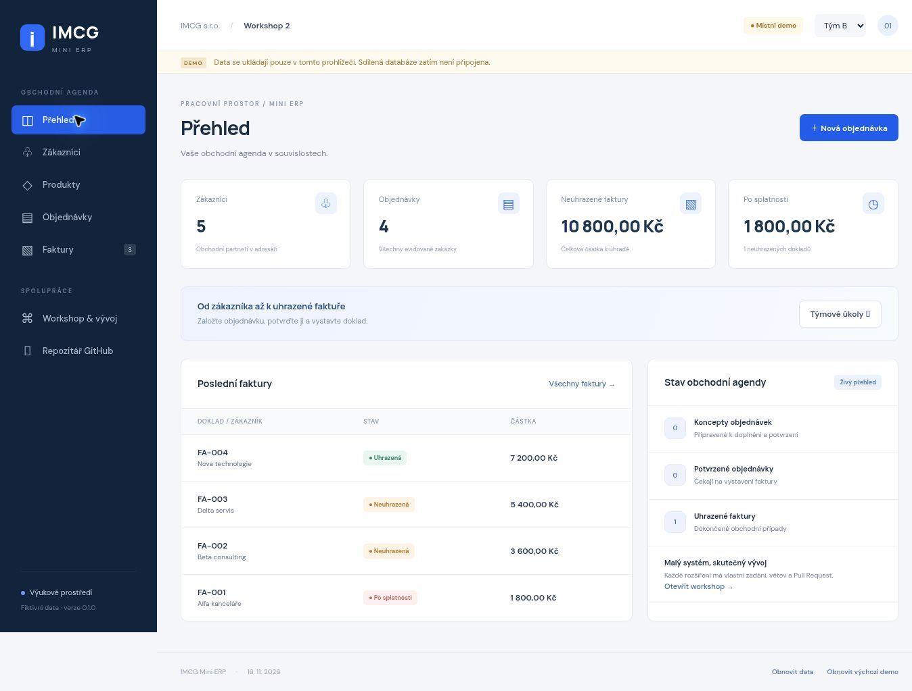

# Záznam ověření mini ERP 0.1

## Aktuální stav — sdílená databáze aktivní

Projekt **Workshop IMCG** v EU je skutečně připojen. Obě migrace (erp a secure_rpc_boundaries) jsou v historii databáze. Prostředí má čtyři pracovní prostory MAIN/A/B/C, sedm účastnických účtů a lektora. Veřejná registrace je vypnutá (ověřeno přes živé Auth settings). Hesla byla předána zvlášť mimo Git.

Prošlo přihlášení všech osmi účtů, čtení vlastního prostoru, sdílení vytvořeného zákazníka mezi účty 01 a 02, odmítnutí cizího prostoru (400), odmítnutí nepřihlášeného (401) a přímého zápisu do tabulky (403). Na živé databázi proběhla objednávka se dvěma položkami, faktura za 56 470 Kč, odmítnutí duplicitní faktury a úhrada. Ověřovací zákazník a uhrazený obchodní případ zůstávají v prostoru A jako označené cvičné záznamy; ostatní prostory mají výchozí data.

Veřejné RPC jsou SECURITY INVOKER; privilegované implementace jsou v neexponovaném erp_private. Znovu ověřené čtení po migraci vrátilo 200. Audit má explicitní zákaz klientského přístupu. Jednorázová administrační funkce je vypnutá (410) a neobsahuje žádnou administrační operaci.

14 lokálních testů a [PR kontroly](https://github.com/IMCG-SRO/cz.imcg.workshop/actions/runs/43851749816) prošly. [Kontroly main](https://github.com/IMCG-SRO/cz.imcg.workshop/actions/runs/43851987398) rovněž prošly. V prohlížeči je ověřené zobrazení přihlašovacího formuláře; samotné nové přihlášení a celý obchodní průchod byly v této fázi ověřeny přes skutečné HTTP API, nikoli vydávány za nové prohlížečové převzetí člověkem.

Bezpečnostní kontrola už nehlásí původní varování k veřejným privilegovaným RPC. Zůstávají upozornění Auth na [kontrolu uniklých hesel](https://supabase.com/docs/guides/auth/password-security#password-strength-and-leaked-password-protection) a [volby MFA](https://supabase.com/docs/guides/auth/auth-mfa). Tyto doplňky nejsou aktivované; jde o cvičné účty s náhodně vytvořenými hesly a fiktivními daty. Health advisors jsou bez nálezů.

**Zbývá:** veřejná adresa přes GitHub Pages, pilot skutečným účastníkem a potvrzení času. Poslední publikační workflow se dokončilo úspěšně jako sestavení; nasazovací job je stále podmíněn ERP_PAGES_ENABLED=true. Úspěšné sestavení se nevydává za zveřejněný web.

---

Následující části zachovávají historii před aktivací Supabase.

Datum: 16. 11. 2026 • Implementace a kontrola: AI na zadání Nikoly Spěšného.
Lidské schválení ani pilot běžným účastníkem nebyly provedeny.

## Výsledek

Základ aplikace je implementovaný v mini-erp/. Funguje místní demo s přetrvávajícími daty v prohlížeči. Online adaptér, databázová migrace, administrační návod a automatizace jsou připraveny; živá databáze a veřejná adresa nejsou aktivované.

## Provedené kontroly

| Kontrola | Skutečný výsledek |
| --- | --- |
| Vitest | 14 testů prošlo: pravidla, zákazníci, produkty, objednávky, faktury, přehled a SQL |
| PostgreSQL přes PGlite | Migrace provedena; ověřena izolace, zamítnutí přímých zápisů, atomický import, serverová cena, uzamčení objednávky, jediná faktura a opakovaná úhrada |
| TypeScript a Vite | Produkční sestavení prošlo |
| GitHub Actions | [PR kontrola](https://github.com/IMCG-SRO/cz.imcg.workshop/actions/runs/43845842787) i [kontrola main](https://github.com/IMCG-SRO/cz.imcg.workshop/actions/runs/43845880871) prošly |
| Čtyři publikační varianty | Main, A, B a C se úspěšně sestavily a zabalily jako artifact |
| Vytvoření seed SQL | Node.js 24 vytvořil seed pro prostor A ze stejné funkce jako místní demo |
| Prohlížeč | Celý níže uvedený obchodní případ prošel v místním demu |

Prohlížečový scénář je zde zdokumentován jako provedený přes nástroj pro ovládání prohlížeče; samostatný Playwright test runner zatím není součástí v0.1. Automatické běžné kontroly jsou Vitest a SQL. Jde o zaznamenané rozhodnutí oproti původnímu návrhu infrastruktury.

## Prohlížečový průchod

1. Otevření přehledu; 5 zákazníků, 4 objednávky, neuhrazeno 10 800 Kč, po splatnosti 1 800 Kč.
2. Založení zákazníka QA01 / Workshop test v prostoru A.
3. Obnovení stránky; zákazník byl nadále dostupný.
4. Objednávka: 2 × Notebook Business 14 po 24 990 Kč + 1 × Monitor po 6 490 Kč.
5. Uložen koncept OBJ-005 s celkem 56 470 Kč.
6. Potvrzení objednávky a vystavení FA-005 se stejným odběratelem a částkou.
7. Označení úhrady; faktura se zobrazila jako uhrazená a počet neuhrazených se snížil.
8. Přepnutí do prostoru B: zákazník QA01 ani jeho doklady zde nebyly; přehled měl výchozí hodnoty.

## Nasazení — konkrétní překážka

[Publikační běh](https://github.com/IMCG-SRO/cz.imcg.workshop/actions/runs/43845880935) úspěšně provedl všechny buildy a balení. Krok deploy skončil 404 s pokynem „Ensure GitHub Pages has been enabled“. Zapnutí Pages nelze provést dostupným připojeným nástrojem a cloudový prohlížeč není přihlášen do GitHubu. Nejde o selhání testů aplikace. Dostupnost Pages pro soukromý repozitář je nutné ověřit podle tarifu.

Správce: [Settings → Pages](https://github.com/IMCG-SRO/cz.imcg.workshop/settings/pages), zvolit GitHub Actions jako zdroj, nastavit repository Variable ERP_PAGES_ENABLED=true a potom spustit publikování z main podle [návodu](../../mini-erp/DEPLOY.md). Veřejnou URL nelze uvést před úspěšným nasazením.

Supabase účet zatím není založen. Správce musí zřídit projekty, spustit migraci, přidat cvičné identity a členství, vložit veřejnou konfiguraci a ověřit přihlášení a bezpečnost ve skutečné službě. [Připravený návod](../../mini-erp/supabase/README.md).

## Historie a další práce

Původních 21 Markdown zadání/scénářů odstraněno v PR #23; Issues #1–#9 uzavřeny jako neplánované, ne jako splněné úkoly. Jednotlivé funkce mají samostatné větve a PR #24–#31. Týmové úkoly #20–#22 jsou stále otevřené a neimplementované.

Úplná online připravenost (#12, #18, #19) čeká na aktivaci služeb, pilot účtem běžného účastníka, konkrétní přiřazení lidí a potvrzení času. Výchozí release tag bude vytvořen až po dokončení tohoto pilotu. Nepovažovat tuto verzi za připravenou pro ostrá firemní data.

Dokud není ERP_PAGES_ENABLED=true, nasazovací job je záměrně přeskočen, aby se neopakovala známá chyba aktivace. Testy, sestavení a artifacty zůstávají aktivní.

## Návazný krok — GitHub integrace Supabase

Uživatel hlásí propojení Supabase s repozitářem. Migrace se přesouvá do standardního supabase/migrations/ v kořeni repozitáře a přidává se config.toml s vypnutým automatickým seedováním. Správné nastavení Working directory je teď tečka. Připojení Supabase do ChatGPT bylo potvrzeno, ale cílová databáze zatím nebyla přečtena a úspěch migrace nelze tvrdit.
